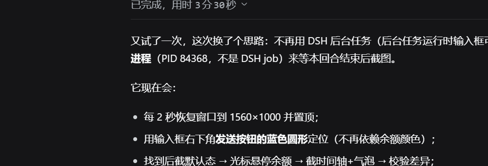
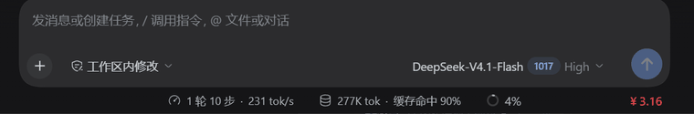

# Peak-Valley Meter (dsh-valley-meter)

<div align="center">

**DeepSeek Harness peak/valley meter · balance badge + hover peak/valley timeline**

**Adapted for DSH 0.2 (0.2.1-rc.2)** · balance-number chip · hover 24h peak/valley timeline · 5s official balance refresh · independent spend metering — 10 curated muted color presets plus custom valley/peak colors.

[](LICENSE)
[](https://github.com/deepseek-ai/deepseek-harness)

**English** | [中文](README.md)

</div>


**Hover to reveal the peak/valley timeline**





## What it is

A **minimal** DeepSeek Harness plugin that shows a low-key **balance number** in the composer footer (bottom-right); hovering reveals a **24-hour peak/valley timeline** along the card's bottom edge:

| Readout | Description |
|---|---|
| **Balance number** | Plain text, no background box, same 13px size as the footer status row, bold. Shows the official account balance by default (the plugin queries `/user/balance` itself, refreshed every 5 seconds). **The whole text is a top-up link** opening the official top-up page in a new tab. |
| **Balance warning color** | Below ¥10 it turns orange, below ¥5 red, and below ¥2 red and blinking; at ¥10 or above it uses the default secondary text color. |
| **Peak/Valley timeline** | A 24h bar revealed on hover along the composer card's bottom edge: 80% of the card width, right-aligned, rounded ends; Peak (orange) / Valley (blue) segments and a glowing white marker at the current local time; on weekends the whole bar is off-peak blue |
| **Today's spend** | Current-day cost (the plugin listens to `llm/stream` and meters in real time into its ledger) |

## DSH 0.2 compatibility

DSH 0.2 changed the plugin kernel in breaking ways; 0.2.0 adapts every affected seam:

- **Typert manifest**: the 0.2 `typert-loader` requires a strict codec with a `create()` factory on every invocation. The manifest is now assembled with `createTypertRemoteInfo()`, matching both the Host and Client registries.
- **Client RPC contribution**: the 0.2 Client Typert registry also requires `create()` on result/parameter codecs; `$mount(contribution)` keeps its contract, but the old `{ mode, typeSymbol, schema }` shape is rejected.
- **`settings` service**: 0.2 keeps only the form surface (`describe/update/configure`) and removed `get(ns)`; balance lookup no longer reads a settings section and uses `credentials.resolve()` plus `DEEPSEEK_BASE_URL` / the built-in official endpoint.
- **`dsh.client` declaration**: 0.2 splits module dependencies into `dsh.client.inject` / `dsh.client.external`; the plugin only uses the baseline `react`, so it no longer declares the removed `dsh-client-runtime` / `dsh-client-ui-slots`.
- **Settings copy**: the 0.2 slot renderer injects `t` from `entry.locale` (a language *namespace*). The plugin keeps its own function-valued dictionary, so it omits `locale` and supplies `t` through its inject face instead of rendering raw keys.
- **Manifest**: adds `dsh.manifestVersion: 1` and `engines.dsh: ">=0.2.0-rc.1"`, which the plugin manager checks before installing.
- **Model price table**: adds the 0.2 model id `deepseek-flash` (DeepSeek-V4.1-Flash), keeps `deepseek-v4-pro`, and keeps old ids for ledger/backward compatibility.

## Key features

- 💳 **One-click top-up**: the whole balance (symbol + number) is a link; clicking it opens the official DeepSeek top-up page (`platform.deepseek.com/top_up`) in a new tab.
- 🚦 **Balance warning color**: orange below ¥10, red below ¥5, and red with a blink below ¥2 (the blink respects `prefers-reduced-motion`). Same 13px size as the footer status row, bold, no background box.
- 🎨 **Color presets**: 10 curated muted presets (One Dark / Dracula / Nord / Tokyo Night / Gruvbox / Solarized + traditional Chinese & Pantone), or custom valley/peak colors via pickers.
- 👆 **Hover to reveal**: only the balance shows by default; on hover the timeline appears along the card's bottom edge (80% of the card width, right-aligned) without taking composer space.
- ⚡ **Live balance**: official balance refreshes every 5 seconds automatically.
- 🕐 **Local-timezone timeline**: peak/valley windows (UTC) are converted to local time; a glowing white marker shows the current moment.
- 🗓️ **Weekend all off-peak (official rule)**: since 2026-08-23 00:00 (Beijing time) Saturday and Sunday are billed at the off-peak price all day. The plugin decides by **Beijing time**, shows an all-valley timeline on those days, meters spend at the off-peak tier (no more double-charging weekends at peak rates) and counts down to Monday 09:00. Can be turned off in the settings panel.
- 🔌 **Fully independent, real-time metering**: the plugin listens to `llm/stream` itself to capture usage, converts it to cost with its own price table, queries the DeepSeek official balance itself, and maintains its own ledger (`~/.dsh/storages/valley-meter/ledger.json`). It depends on no other plugin.

## Install

### Option 1: local link (development / personal use)

```bash
# in the plugin repository
pnpm install

# link it into the current profile (desktop for the desktop app; web for dsh web)
dsh plugin --profile desktop add link:/absolute/path/to/dsh-valley-meter
```

Then append a row to the profile's `cordis.patch.yml` (or select the bundle in the plugin manager):

```yaml
- insert:
    - id: valley-meter
      name: dsh-valley-meter
```

HMR recomposes the profile and the browser loads the new client bundle without a restart.

### Option 2: market install

A DSH 0.2 plugin market is a self-hosted format-1 index. This repository's index is hosted on GitHub Pages:

```text
https://uckkk.github.io/dsh-valley-meter/market/index.json
```

Open **Plugins → More → Custom plugin markets → Discover → Add index source**, paste that URL, then search "valley / peak / balance" and install from **Discover**. The index currently pins a Git commit (GitHub source), so it does not depend on an npm release.

Or install from the CLI:

```bash
dsh plugin --profile desktop add "git+https://github.com/uckkk/dsh-valley-meter.git#<commit>"
```

Once a release is on npm, the index `source` can switch to `{ "type": "npm" }` and `dsh plugin add dsh-valley-meter@0.2.0` works too.

## Configuration

Open **Settings → Peak-Valley Meter**:

- **Color presets**: 10 presets (6 editor themes + 4 traditional Chinese / Pantone) or "Custom".
- **Valley color / Peak color**: color pickers, applied instantly when Custom is selected.
- **Balance title** / **Today title** / **Show countdown**: independent toggles.
- **Weekend all off-peak**: on by default. Since 2026-08-23 the official rule bills Saturday and Sunday at the off-peak price all day; turn this off to fall back to plain peak/valley windows on weekends.

Config is written to `~/.dsh/storages/valley-meter/config.json`.

## Data source

The plugin meters and queries on its own, with no dependency on other plugins:

- **Today's spend**: listens to `llm/stream` to capture each call's usage, converts it with the built-in model price table (peak/valley tiers) plus the peak/valley windows, and writes it to its own ledger `~/.dsh/storages/valley-meter/ledger.json`.
- **Account balance**: resolves `DEEPSEEK_API_KEY` through DSH 0.2's `ctx.credentials.resolve()` (re-read on every operation, so a rotated key needs no restart) and queries the DeepSeek official `/user/balance` endpoint; refreshed automatically every 5 seconds.
- **Peak/valley windows**: built into the plugin (default UTC 01–04, 06–10 = Beijing 09:00–12:00 and 14:00–18:00) and stored as `peakWindows` in config.json; the settings panel only exposes the weekend-rule toggle, not a window editor.
- **Weekend rule**: since 2026-08-23 00:00 Beijing time, Saturday and Sunday are billed at the off-peak price all day. On weekdays the peak hours are Beijing 9:00–12:00 and 14:00–18:00, and the off-peak price is half the peak price. The weekend test is done in Beijing time, and moments before the rule took effect still use the old windows.

When no API key is configured the balance shows "No data" while today's cost keeps accumulating — it never errors.

## Development

```bash
pnpm install
pnpm test    # node:test: peak/valley/weekend/billing + Typert manifest and codecs
pnpm build   # artifact consistency checks (hand-authored bundles, no bundler)
pnpm check   # syntax check + test + build
```

`lib/` is hand-authored: `lib/index.js` (Host), `lib/typert.host.js` (Typert manifest), and `lib/client.js` (single-file browser bundle). `build.mjs` checks the manifest, exports, registration id, and strict codecs; it does not bundle.

## License

MIT
